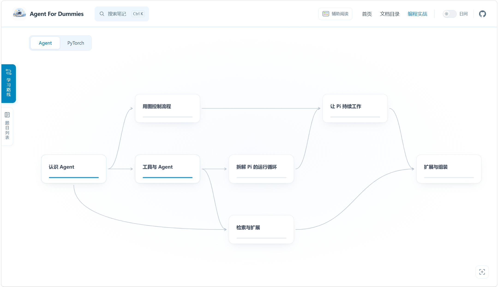
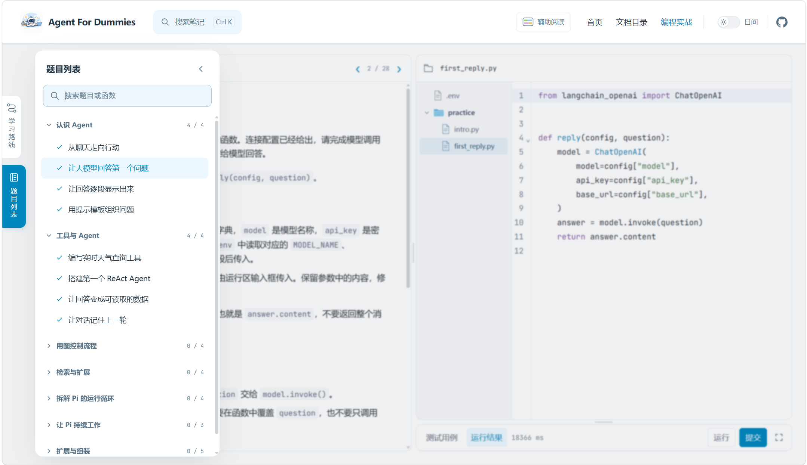
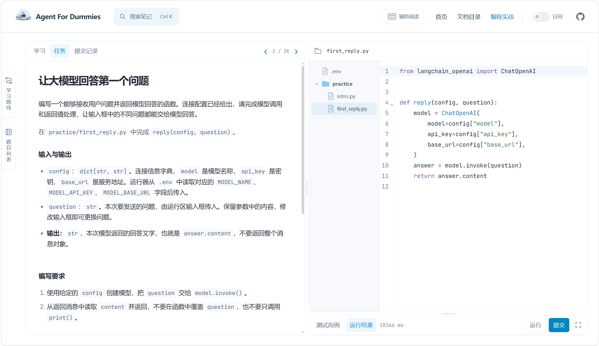
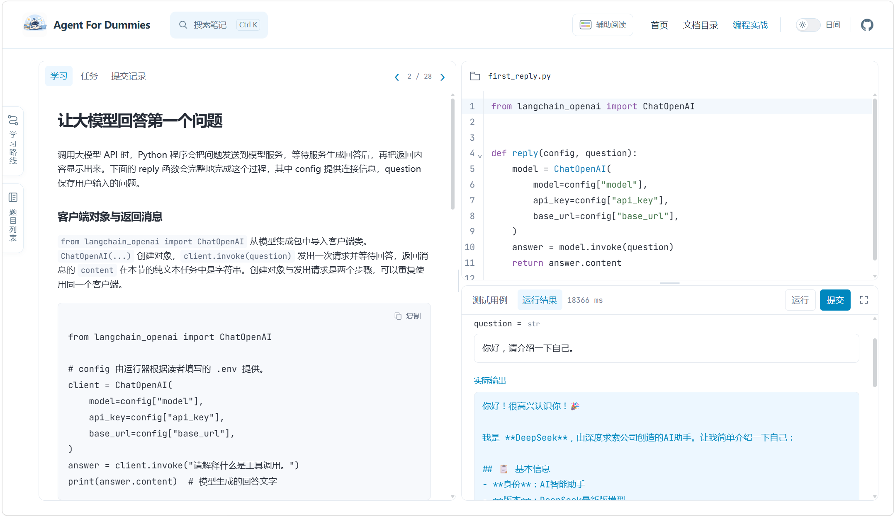
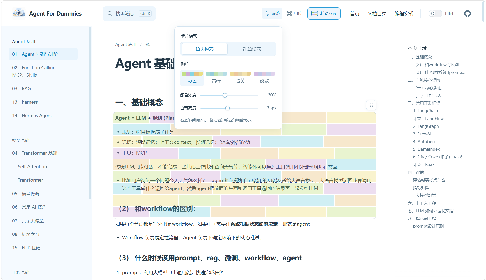
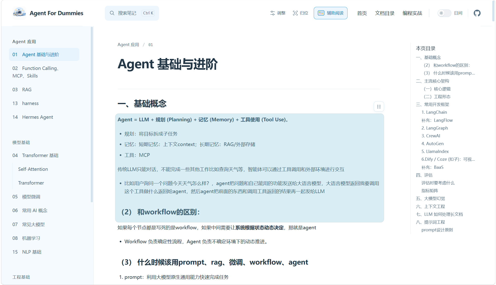
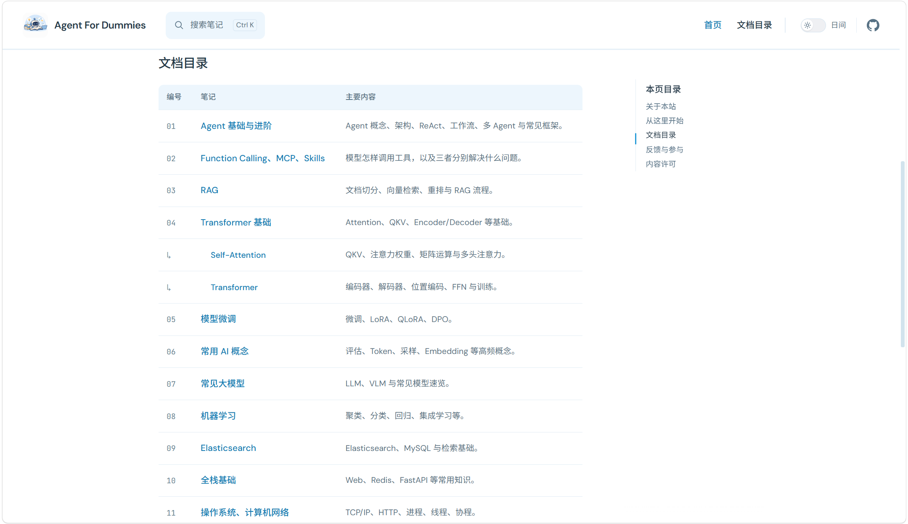
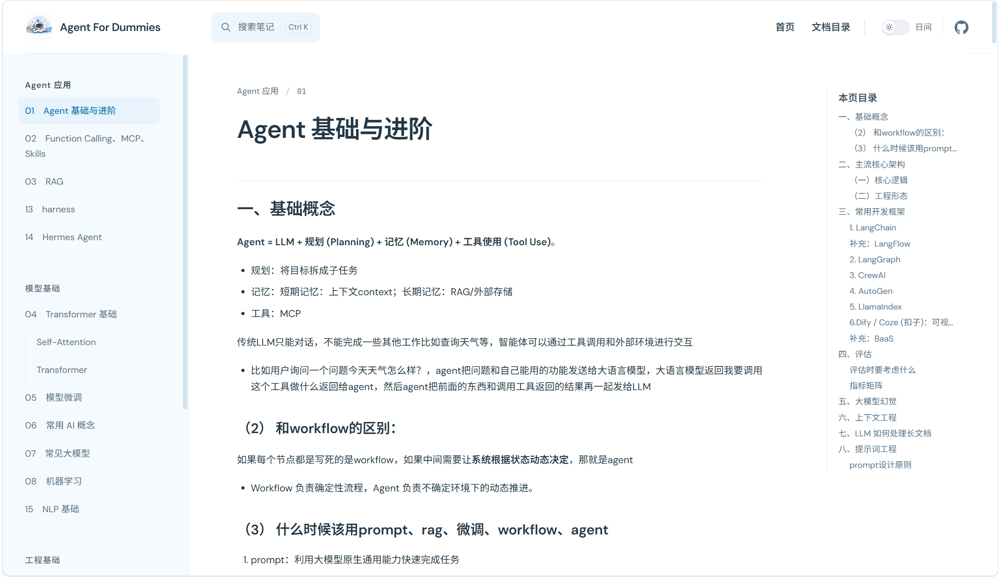
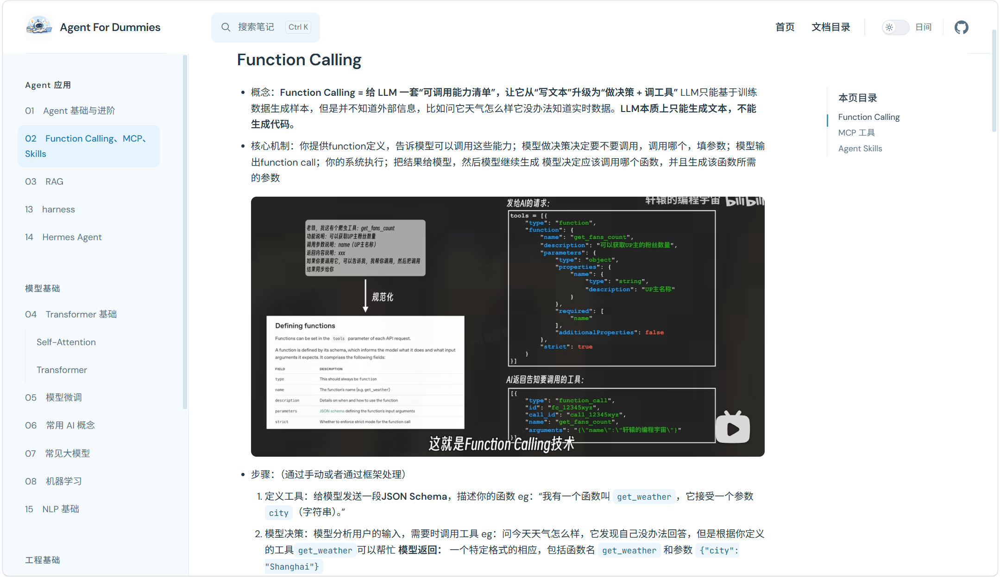
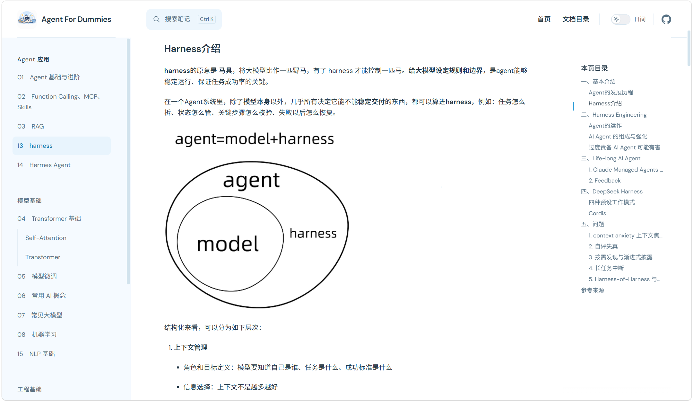

# 🤖 Agent For Dummies | Agent 基础入门编程平台➕学习笔记
1️⃣Agent笔记在线阅读：https://agent-for-dummys.github.io/Agent-For-Dummies

2️⃣也可以下载到本地自行编辑md文档对笔记进行补充完善。


## 【📢速览】——10月新增

- Hermes/Harness/Transformer/NLP基础/全栈基础 相关学习笔记文档（持续更新）
- PyTorch 与 Agent 从 0 到 1 快速入门编程平台（持续更新）
- 阅读友好功能


## 【💡新增！！⌨️持续更新中】PyTorch 与 Agent 从 0 到 1 快速入门

这是一个帮助初学者快速学习并上手 PyTorch 和 Agent 的基本函数入门编程平台，旨在帮助所有一下子看不懂整个项目 or 长代码的朋友快速了解并熟悉常用代码。

由于预算有限，请有需要的朋友们下载或者克隆源码到自己电脑里（欢迎大家 fork 并通过 Issue 或 Pull Request 补充、纠错٩(ˊᗜˋ*)و），需要安装 Node.js 22 或更新版本，以及 Python 3.12～3.14。在项目目录执行：

```sh
npm run setup
npm run learn
```

首次安装需要联网下载依赖，之后只运行 `npm run learn` 即可同时启动网页和服务。

打开网页之后可以看到学习路线图总览：


点击对应的模块可进入编程学习，部分题目列表及编程平台界面预览（持续更新中）：





## 🌈阅读友好功能

新增ADHD阅读友好功能，预览如下：




## 📋笔记文档预览
笔记目录：


内容预览：




## 说明
这是agent/RAG/大模型学习 个人学习笔记与Agent入门编程平台，风格比较简洁精炼，图文结合，零基础/adhd友好，正在持续更新中。欢迎star追更！！！
欢迎通过 Issue 或 Pull Request 补充、纠错或提供更好懂的解释。

笔记原创文字采用 [CC BY 4.0](LICENSE) 发布。
