### 前端小知识

可以先把开发一个网页理解为装修和运营一家商店，快速理解：
- HTML：搭建商店，决定哪里有货架、商品、收银台。
- CSS：装修商店，决定颜色、布局、大小和视觉效果。
- JavaScript：让商店能够运作，比如点击按钮加入购物车、计算价格。
- Node.js：让电脑能够运行开发网站所需的工具。
- npm：帮你下载并安装这些工具，比如 Vite。
- Vite：运行正在开发的网站，让你边写代码边看效果，最后再打包发布。

#### HTML
超文本标记语言

一个网页可能包含标题、段落、图片、按钮和输入框。HTML 就是用不同的标签告诉浏览器，这些内容分别是什么。

```html
<h1>我的学习网站</h1>
<p>欢迎来到 Agent-For-Dummies！</p>
<button>开始学习</button>
```
浏览器看到这些标签，就能明白：
- `<h1>`：这是一级标题。
- `<p>`：这是一个段落。
- `<button>`：这是一个按钮。

但是，HTML 创建了按钮，并不意味着按钮已经具备具体功能。例如，点击“开始学习”后切换页面或加载内容，通常还需要 JavaScript 或其他机制来实现。

#### CSS
层叠样式表（Cascading Style Sheets），可以控制页面颜色、字体、间距、尺寸、动画和响应式布局

例如，HTML 创建了一个按钮，但我们希望这个按钮是蓝色的、带圆角，并且鼠标悬停时颜色发生变化，就可以使用 CSS。
```css
button {
  background-color: #b7d5f5;
  color: white;
  border: none;
  border-radius: 8px;
  padding: 12px 20px;
}

button:hover {
  background-color: #85bdfa;
}
```
常见的三种使用方式：
1. 内联样式：直接写在 HTML 元素的 `style` 属性里
2. 内部样式表：写在 HTML 的 `<style>` 标签里
3. 外部样式表：将 CSS 单独保存在 `.css` 文件中，再通过 `<link>` 引入（通常使用这个，方便维护）

#### JavaScript
是一门编程语言，负责处理网页中的交互行为和业务逻辑。

例如，我们希望点击按钮之后，页面上的数字加一，可以这么写：
```JavaScript
let count = 0;

const button = document.querySelector("button");

button.addEventListener("click", () => {
  count++;
  document.querySelector("h1").textContent = count;
});
```
- `querySelector()`：找到 HTML 页面中的元素。
- `addEventListener()`：监听用户的点击操作。
- `textContent`：修改页面中的文字。

此外，JavaScript 还可以处理数据、发送网络请求、更新页面内容，实现各类复杂的业务功能。

可以运行在浏览器或 Node.js 中。

#### Node.js
基于 Chrome V8 引擎的 **JavaScript 运行时**

让 JavaScript 可以脱离浏览器，用于后端服务、命令行工具、构建工具和自动化脚本。  

提供文件系统、网络、进程等 API，npm 和 Vite 都运行在 Node.js 上

#### Vite
开发服务器和构建工具，能够高效开发和打包前端项目

可以配合 Vue、React，也可以用于普通 HTML/CSS/JavaScript 项目

提供**冷启动**和**热更新（HMR）**，修改模块后，很多情况下无需刷新整个页面，并负责生产环境打包，生成适合部署的资源
#### npm
是 Node.js 生态常用的包管理器，通常随 Node.js 一起安装

管理项目依赖，安装、卸载、更新第三方包
- `npm install`：安装需要的软件包
- `npm run dev`：调用 Vite，启动开发服务器
- `npm run build`：调用 Vite，对项目进行生产环境构建

### Redis
#### 1. 定义
remote dictionary server 远程字典服务器，是一个基于内存的KV（键值对）存储系统，通过key快速查到对应的value值，可以用作数据库、缓存和消息中间件。支持多种类型的数据结构，提供远程缓存服务。单线程，比较快，比sql查的快很多，基于C语言实现。

**基本流程**：第一次查询时，先从Redis中查找，如果没有找到再从mysql数据库中找，然后把结果存到Redis中，并设置过期时间，后续相同分布式Session问题的查询就能直接从Redis返回结果

#### 2. 数据结构
可以看成是一个键值对字典，键只能是字符串（底层是 SDS），但是值支持以下数据类型：
##### （1）字符串（String）

本质上是C语言的字符数组，但是加上了一点标识属性。

- `len`：记录字符串当前长度。
- `alloc`：记录分配的总容量（不包括头和结尾的 `\0`）。
- `flags`：低三位表示 SDS 的类型（有 `sdshdr5`、`8`、`16`、`32`、`64` 五种）。
- `buf[]`：真正存储数据的字节数组。


- **为什么Redis不直接采用C语言的字符串做具体实现？**
	- 因为 C 字符串获取长度需要O(n)复杂度，而SDS直接读是 O(1)
	- C 字符串修改容易造成缓冲区溢出，且每次修改长度都要重新分配内存
	- C 字符串遇到 `\0` 就会截断，导致无法存储图片、视频、压缩文件等包含`\0`的二进制数据
##### （2）链表（List）

早期的底层实现是双向链表。
	
双向链表的节点实现：
``` c
typedef struct listNode {
	struct listNode* prev;
	struct listNode* next;
	void* value;
} listNode;
```
	
list结构体，持有链表的头、尾和长度：
```c
typedef struct list {
	listNode *head; // 表头节点
	listNode *tail; // 表尾节点
	unsigned long len; // 链表所包含的节点数量
	void *(*dup)(void *ptr); // 节点值复制函数
	void (*free)(void *ptr); // 节点值释放函数
	int (*match)(void *ptr, void *key); // 节点值对比函数
} list;
```

常见API函数：
- `lpush`：向链表左边增加元素
- `rpush`：向链表右边增加元素
- `lpop`：弹出左侧第一个元素
- `rpop`：弹出右侧第一个元素
- `llen`：获得链表长度
- `lrange`：按索引范围获得值
- `lrem`：删除指定数量的匹配元素
- `linsert`：在某个元素前/后插入新元素
- `lindex`：获取指定索引位置的元素
	
Redis 3.2之后，为了节省内存并减少碎片，底层实现改为了QuickList（宏观上是一个双向链表，但链表的每个节点挂的是一个 **ziplist**）
	
##### （3）哈希表（Hash Table）
是一种存储数据的结构，键和值一一对应，可以通过键Key，在 $O(1)$ 时间复杂度下获得对应的值。
	
C语言没有内置哈希表，所以 Redis 自己实现了哈希表。
	
采用**拉链法**作为哈希表的实现。当发生冲突时，新的键值对会采用**头插法**插入到对应桶的链表中。
	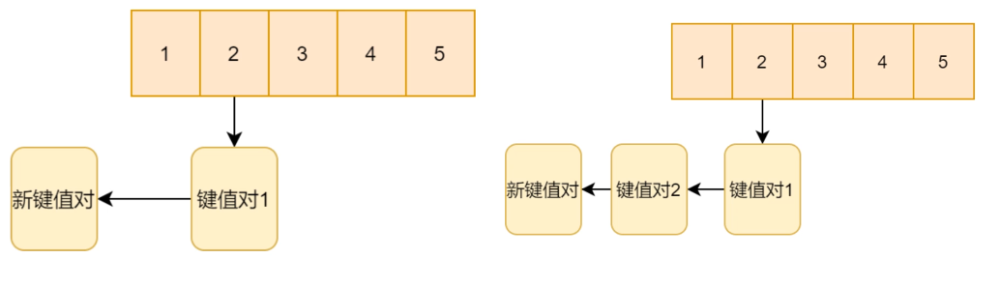
- `dictht`：通常意义上理解的哈希表
- `dictEntry`：哈希表的一项，可以看作一个键值对
- `dict`：Redis给外层调用的哈希表结构，包含两个dictht
```c
typedef struct dictht {
    dictEntry **table; //哈希表数组（哈希表项集合）
	unsigned long size; //Hash表大小
    unsigned long sizemask; //哈希表掩码，可以规避溢出的情况
    unsigned long used; //Hash表已使用的大小
} dictht;
```
键值对
```c
typedef struct dictEntry {
	void *key;
	union {
	    void *val;
		uint64_t u64;
		int64_t s64;
		double d;
	} v;
	struct dictEntry *next;
} dictEntry;
```
	
由于空间变大或缩小，之前的键在老表的存储位置，在新表中就不一定一样了，需要重新计算。这个重新计算，并把老表元素转移到新表元素的过程就叫做rehash。
- `rehashidx == -1`：表示当前没有在进行 rehash。
- `rehashidx >= 0`：表示当前正在 rehash，且记录着 `ht[0]` 中当前已经迁移到 `ht[1]` 的桶的索引位置。
```c
typedef struct dict {
	dictType *type;
	void *privdata;
	dictht ht[2];
	int rehashidx;
} dict;
```

Redis 采用了**渐进式 rehash**：
- 在 rehash 期间，不一次性完成，而是每次对字典进行增、删、改、查时，顺带将 ht[0] 中 rehashidx 索引上的所有节点迁移到 ht[1]，然后将 rehashidx 加 1。
- 在这个期间，新写入的键值对**直接写入 ht[1]**，保证 ht[0] 只减不增。
- 查询时，会先在 ht[0] 查，查不到再去 ht[1] 查。
- 直到 ht[0] 全部迁移完毕，rehashidx 重新置为 -1，并把 ht[0] 指向 ht[1] 原来的地址，ht[1] 重置为空表。
		
##### （4）集合（IntSet）
- 普通集合
	
	通用，底层用哈希表实现。
- 整数集合
	
	集合中只有整数，是有序数组，采用二分法查询这个数是不是在集合中，时间复杂度为 $O(logN)$。
		
	有三种编码：`int16_t`、`int32_t`、`int64_t`。如果当前集合全是 `int16`，这时插入一个 `int32` 的整数，IntSet 会自动**升级**整个数组。
		
	**编码转换（触发条件）**  
	当集合元素**全是整数**，且元素个数不超过配置项 `set-max-intset-entries`（默认 **512**）时，使用 **IntSet** 编码。
	一旦插入**非整数**元素，或者元素数量**超过 512**，底层会立刻转换为 **Hashtable** 编码。
	    
##### （5）有序集合
**跳表**：基于单链表的数据结构。元素有序，查找任意元素复杂度为 $O(logN)$。
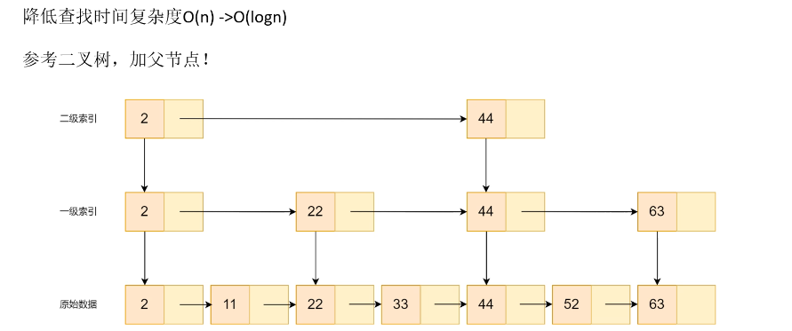
	
- **原始数据层** 对应 `level[0]`（底层）。
- **一级索引层** 对应 `level[1]`。
- 以此类推

图中值为 **2** 的节点，因为它同时出现在原始数据、一级索引和二级索引中，所以它的 `level` 数组长度为 3。

`level[0]` 指向同层（原始数据层）的下一个节点 11

`level[1]` 指向同层（一级索引层）的下一个节点 22

`level[2]` 指向同层（二级索引层）的下一个节点 44
	
**插入新元素的具体方式**：Redis 跳表在插入节点时，会随机决定这个节点的层数。初始层数为 1，然后生成一个随机数，如果小于 0.25，就再加一层，直到停止。
	
**Redis 跳表节点定义**
```c
typedef struct zskiplistNode {
	sds ele; //元素，在热词情景中，就变成了一段文字
	double score; //权重值，热词情景下就是热度
	struct zskiplistNode *backward; //指向后面的指针
	struct zskiplistLevel {
	    struct zskiplistNode *forward;//指向同层的下一个节点
	    unsigned long span;//记录从当前节点到forward指向的节点，中间跨越了多少个底层节点
	} level[]; //节点的level数组，就是跳表里每个节点背后那一筐
} zskiplistNode;
```
**Redis 跳表定义**
```c
typedef struct zskiplist {
	struct zskiplistNode *header, *tail;
	unsigned long length;
	int level;
} zskiplist;
```

`span` 字段记录了从当前节点到同层下一个节点之间，**在底层链表中跨越了多少个节点**。

要查找某个元素的排名（`zrank`）时，可以从跳表的最高层开始往下找，每沿着 `forward` 指针前进一步，就把当前层的 `span` 累加起来。最终累加的总和，就是该元素在底层链表中的位置，也就是它的排名。

- 以下图为例，计算33的排名。
	1. **二级索引层：**
	   
	   检查 `x->level[2].forward`：指向 `44`，`44`的score大于`33`，不能前进，降级到一级索引。
	1. **一级索引层：**
	   - 当前x=2，检查 `x->level[1].forward`：指向 `22`，`22` 的 score < 33，可以前进，累加`span` → `rank = 0 + 2.level[1].span`，`rank = 3`
	   - x=22，继续检查`x->level[1].forward`，指向`44`，不能前进，降级到底层。
	1. **底层：**
	   - 当前 x = 22，检查 `x->level[0].forward`：指向 `33`，`33`的score == 33，可以前进，累加 `span`：`rank += 22.level[0].span = 1` → `rank = 4`
	   - x = 33，找到目标。退出。
	1. **结果：**
	 
	   累加得到的`rank = 4`，表示 `33` 在底层链表中是第 4 个节点，$zrank(33) = 4 - 1 = 3$
	
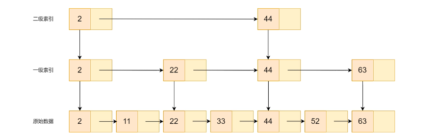
	
常用函数：
- `zadd`：增加元素，如`zadd mZySet 100 niu`，添加元素niu，score为100  
- `zcard`：查询zset元素个数。  
- `zrank`：获取元素在zset的位置，如`zrank mZySet niu`，返回niu字段在zset的位置  
- `zcount`：获取指定score之间存在的成员个数，如`zcount 9 99`，获取在9到99元素个数  
- `zrangebyscore`：获取指定score之间存在的成员。如`zrangebyscore myZSet 9 99`获取在9到99元素  
- `zrem`：删除元素，如`zrem mZySet niu`，删除元素niu。  
- `zscore`：获取指定值分数，如`zscore mZySet niu` 获取niu的分数
- ...
	  
**ZSet**
1. **小数据量时**：使用**紧凑列表**实现。
	- Redis 7.0 之前：`ziplist`
	- Redis 7.0 及之后：`listpack`
2. **大数据量时**：转换为 **跳表（skiplist）+ 哈希表（dict）**。
	
#### 3. 持久化
Redis 是**内存型数据库**，优点是内存读取速度快，缺点是数据易失，一旦缓存服务重启或者断电，内存就全丢了，所以要加上持久化。一般通过 **RDB**（定期把内存数据保存到硬盘，像拍照一样） 和 **AOF** （把每个写操作都记录下来，像记日记，数据更安全但是恢复比较慢）解决。
##### （1）RDB
**全量备份**。把目前 Redis 内存中数据**生成一个快照**（dump.rdb），保存在**硬盘**中，如果发生事故，Redis 可以通过 RDB 文件，进行文件读取，并将数据重新载入内存中。
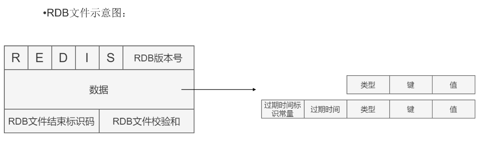
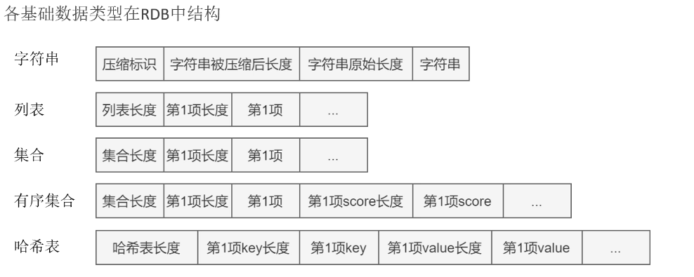

- RDB 触发条件：
	- 手动触发
		- `save`：执行该指令后，主线程执行`rdbSave`函数，服务器进程阻塞，不能处理其他请求。
		- `bgsave`：和`save`差不多，区别是这个命令fork一个子进程，去执行`rdbsave`函数，主线程可以执行新请求。
	- 自动触发
		- 配置文件中写入`save m n`，代表当m秒内发生n次变化，会自动执行`bgsave`
		- 主从复制时，从节点首次连接主节点会触发 `bgsave`
		- 执行 `shutdown` 命令时，如果没有开启 AOF，会自动执行 `save`
##### （2）AOF
**增量备份，记录所有写命令**。
	
如果发生事故，Redis 可以通过AOF文件，把文件中数据修改命令全部执行一遍，以此恢复数据。把操作命令追加到老文件下面。
	
AOF 文件会越来越大，需要 **AOF 重写**（`bgrewriteaof`）。
	
- AOF 触发条件
	- 手动触发：`bgrewriteaof`，fork 一个子进程，读取当前内存中的数据，用最少的命令重新生成一个 AOF 文件，然后替换旧文件。
	- 自动触发：配置文件中设置 `appendonly yes` 开启
		- `Always`：同步写回，每个写命令执行完成后，直接将命令落入磁盘文件。
		- `Everysec`：每秒写回，默认策略。
		- `No`：将全部操作命令只写到 Redis缓存区，何时写入磁盘由操作系统决定。
- AOF 流程图
	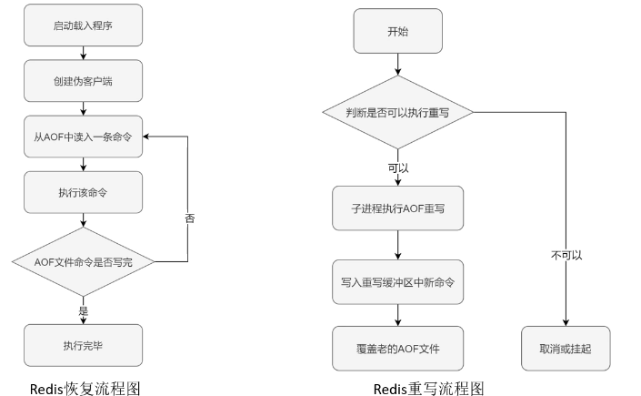
	
- 混合持久化
	配置项 `aof-use-rdb-preamble yes`（默认开启）
	AOF 重写时，文件开头会先写入 RDB 格式的全量快照，后面再追加 AOF 格式的增量命令。

如果同时存在 RDB 和 AOF 文件，**优先加载 AOF**，因为 AOF 通常数据更完整。

#### 4. 缓存
##### （1）缓存淘汰
- **先进先出 FIFO**：最先进去的最先淘汰。
- **最近最少使用 LRU**：把数据按最近访问的时间排序（当下访问了就放在链表最前面），把没有被访问的时间最长的淘汰。可以利用双向链表+哈希表的形式存储（比较高效）。
- **最不经常使用 LFU**：最少使用的被淘汰。多一个字段，保存被访问次数，通过链表实现。
	
##### （2）过期删除
- **定时删除**
	设置删除间隔时间，主动删除这些过期数据。缺点是当Redis比较忙时，设置删除时间碰巧到期了，主动删除会额外增加Redis负担。
- **惰性删除**
	程序取值时查看该数据是否已经过期，如果没过期就返回，如果过期就删除。这种方法服务器运算资源占用小，但是容易造成某些数据长期霸占在内存中不被删除的情况。
- **定期删除**
	最常用的方式。定时删除和惰性删除的结合，每隔一段时间，跑一次主动删除。不跑主动删除时，就执行惰性删除策略。
	
##### （5）缓存一致
缓存的数据和后端数据库中的数据保持一致。当缓存的数据有更新值的时候，不是更新缓存数据，而是删除缓存数据。
	
- **Cache Aside**
  
	两种方式：
	- model1
	
		**删除缓存，再修改数据库中的数据**。
		
		写请求慢于读请求，client 1 修改数据库的操作一般晚于client 2 查询数据库更新缓存的操作，导致后续用户读到缓存的旧数据。
		
		比方说如图，时刻2已经删除了缓存数据，这个时候如果client 2 查询缓存，会失败，在时刻3取查询数据库，但是修改操作还没有完成，所以在数据库中会读到旧数据，而且旧数据又写入了缓存。到时刻5，client 3查询缓存，读到了旧数据。
		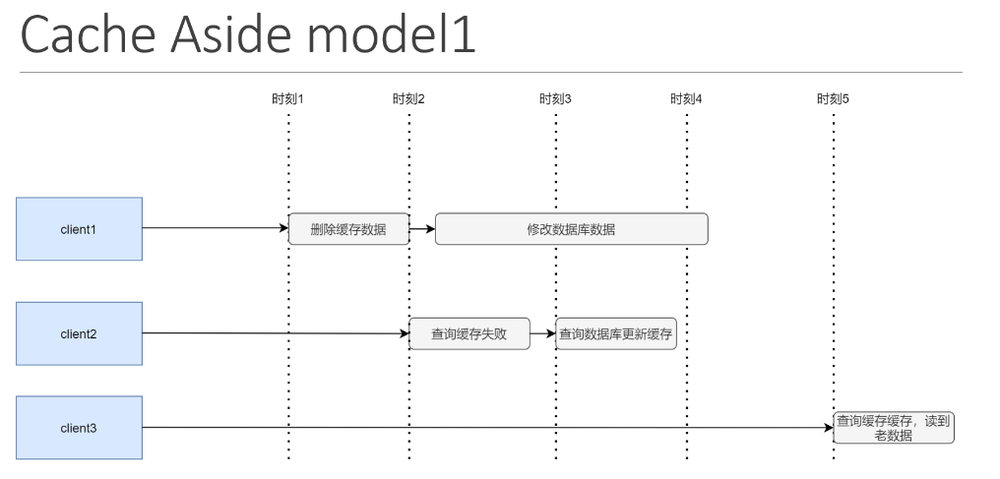
		采用延时双删策略，解决了这个问题。
		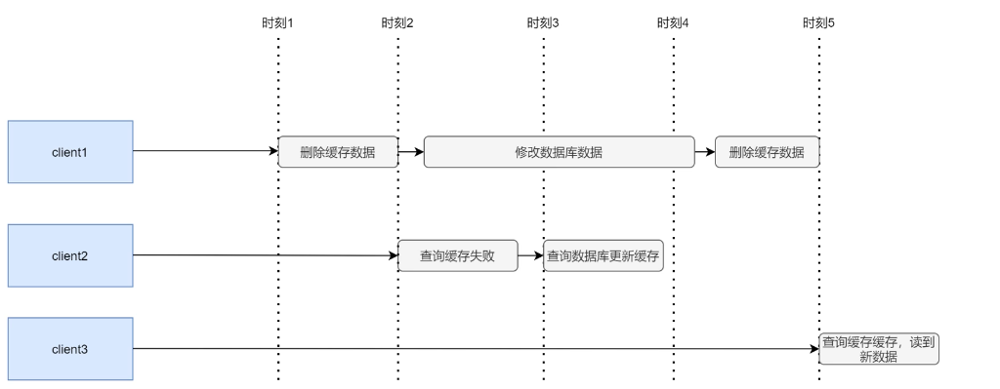
		
	- model2（推荐）
		**修改数据库中的数据，再删除缓存**。
		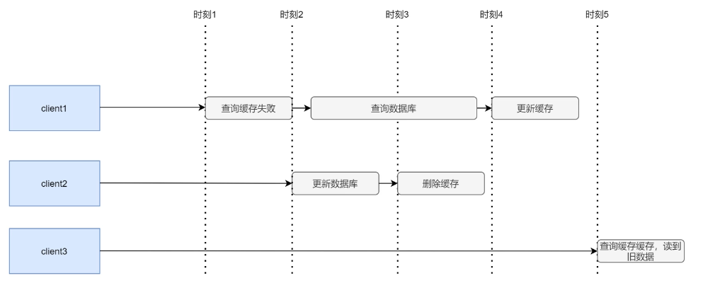
		
- Read/Write Through
	应用把缓存作为主要的数据读取方式，保证一致性。
	Cache Aside是删除缓存，Read/Write Through是更新缓存。

- Write Behind
	- 可以将更新步骤放到消息队列中，异步执行
	- 也可以模拟MySQL主从复制，让MySQL认为它是从节点，从而将更新的binlog源源不断发给canal，再将binlog进行解析，转为结构化数据，给下游程序使用，就可以结合canal，把新数据更新到redis缓存之上。
		
##### （4）缓存穿透
- 查询一个数据库也不存在的数据，即缓存查不到，数据库也查不到，就穿透了。
- 解决方法：
	- 拦截非法查询请求
	- 缓存空对象：即使mysql查询结果为空，仍将空缓存存在redis里，并且设置一个较短的过期时间，后续相同请求回直接命中缓存的空值
	- 布隆过滤器：如果全是 1，说明可能存在。不会漏判，但可能误判
		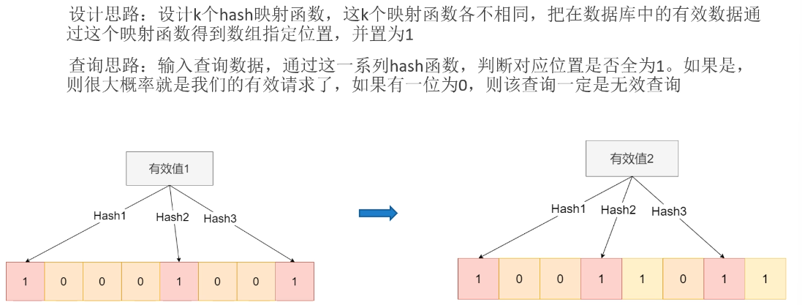
		
##### （5）缓存击穿
- 热门数据突然过期，大量请求全都涌向数据库，数据库就宕机了。
- 解决方法：
	- 从MySQL角度出发：
		- 限流：限制打到 MySQL 的请求速率
		- 熔断：出现大量超时或错误时，直接切断本次调用
		- 降级：当限流或熔断触发时，给用户返回一个“兜底”结果
	- 从Redis角度出发：
		- 设置热点数据永不过期
		- 热点数据后台启动一个异步线程，数据要过期的时候，把数据的过期时间刷新一下，或者把数据回填缓存层
	- 应用层协调机制：可以用互斥锁让请求排队一个一个来，第一个请求用来重建缓存，其他的就可以直接查redis了
	
##### （6）缓存雪崩
- 一大批被缓存的数据同时失效，对于这一批的数据请求全打到数据库上，数据库宕机。
- 发生雪崩的可能原因：
	- 大量key同一时间过期
	- Redis实例宕机或者集群故障
	- 刚开机缓存未加载
- 解决方法：
	- 从MySQL角度：
		- 限流
		- 熔断
		- 降级
		- 用互斥锁
	- 从Redis角度：
		- 过期时间加随机值
		- 设置热点数据永不过期 + 异步刷新
		- 分析失效时间，尽量让失效时间点分散
		- 缓存预热，在上线前，根据当天的情况分析，将热数据直接加载到缓存系统

#### 5. 集群
##### （1）主从复制
把一台机器设置为主库，其他机器设置为从库。主库执行修改命令，从库会与主库保持数据一致性，进行数据同步。客户端会向从库执行读命令，向主库执行写命令。主从复制是**异步**的。

- **流程**
	1. 从库启动后与主库握手，发送 `PSYNC` 命令，携带主库 `runid` 和自身 `offset`。
	2. 主库判断：若 `runid` 匹配且 `offset` 在合法范围内，则执行**部分复制**，否则执行**全量复制**。
	
	**全量复制**：初次复制后的同步
	- 主库执行`bgsave`，生成对应的RDB文件，同时用复制缓冲区记录新写命令
	- RDB文件产生后，主库发送给从库，从库清空自身数据后加载，加载完主库再把缓冲区命令发给从库
	
	**命令传播阶段**
	主库每执行一个写命令就异步发给从库。
	
	**部分复制**：断线后重复制
	从库与主库断线重连后复制。
	- run id：识别主库身份
	- offset：代表主节点传输了的字节数
	- 复制积压缓冲区，FIFO，存储了最近主节点的数据修改命令
	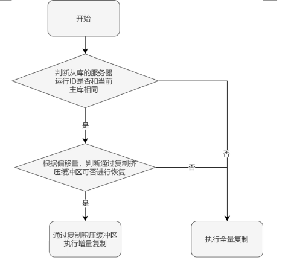
	
##### （2）哨兵
哨兵是 Redis 的高可用方案，不提供数据服务，只负责监控、通知和故障转移。

如果主库坏了，哨兵组进行投票，从从库中重新选出主库。是一个不提供数据服务的Redis服务器。
	
- 流程
	- 哨兵监控的每台机器一定时间会发送信息（心跳），如果一定时间收不到心跳，就默认这台机器断联了。
	- 当某个哨兵在规定时间范围内收不到主库心跳，会先标记为**主观下线**。然后向其他哨兵询问，如果达到 `quorum` 个哨兵都确认，就标记为**客观下线**。
	- 客观下线后，哨兵们会基于 Raft 算法选举出一个**领头哨兵**，由它执行故障转移。
	- 并从从库中挑一个新的当主库。选主库的原则是：
		- 先看优先级，数值越小，优先级越高
		- 再看offset，offset越大，从库数据越新
		- 最后看run id，选最小的
	- 选出新主库后，向它发送`SLAVEOF NO ONE`，并通知其他从库，老大已经换人了，要复制新主库的数据，并把旧主库也配置为新主库的从库。原来的主库就算重新上线，也会被降级为从库，当不了老大了。
	
##### （3）集群
- **虚拟槽**

	是 Redis 的分布式方案，把数据分到 16384 个虚拟槽，每个cluster节点负责一部分槽数据的存储。键通过 `CRC16(key) mod 16384` 决定槽位。
	
	主节点负责槽的读写，从节点复制主节点数据，用于故障转移。
	
- **槽迁移**

	扩容和缩容时，数据会发生迁移，有可能会出现某个槽一部分数据在原来节点上，一部分数据在新的节点上。
	
	客户端访问时
	- 如果键不在当前节点，会收到 MOVED 重定向（告诉你应该去哪找），更新本地路由
	- 如果槽正在迁移，会收到 ASK 重定向（告诉你去哪找，并且提醒你数据没有搬完），临时去目标节点查，不更新路由
	  
- **传播**

	每个节点都会存储整个集群节点信息，这些信息也被称为元信息
	
	这个节点存储的元数据包括在该节点视角下：
	- 各节点存储的槽数据
	- 各节点的master和slave状态
	- 各节点是否存活
	- ...
	
	元数据信息的传播：gossip协议，一传十，十传百，每个节点定期开一个固定人数的茶话会，把自己的数据信息通过这个协议散播出去
	
- **故障转移**

	主节点挂掉后，从节点发起选举，获得多数主节点投票后成为新主节点并接管槽。如果某个槽的主从节点全部挂掉，那么整个集群都将不可用。

#### 6. 问题
1. **Redis本身也扛不住高并发**
	- 建立多级缓存，从服务器本地缓存，到redis分布式缓存，再到数据库
	- 缓存预热，在上线前，根据当天的情况分析，将热数据直接加载到缓存系统

2. **Redis服务器挂了怎么办**

	部署主从集群，主节点负责写数据，从节点实时同步主节点的数据。主节点挂了，从节点立即顶上
   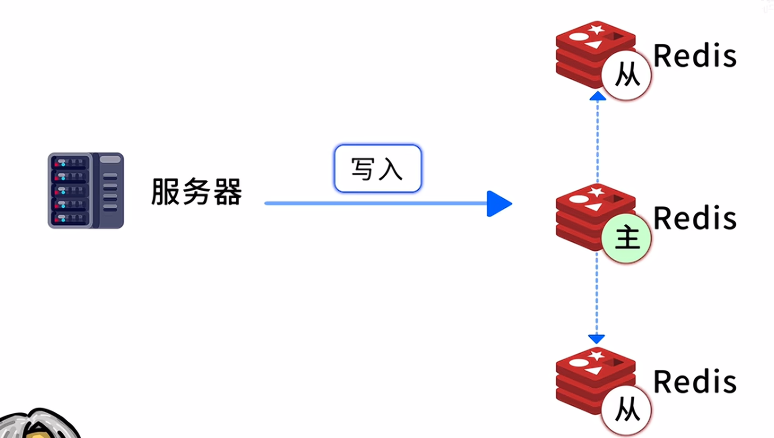
3. **主节点挂了，谁来决定哪个从节点升级**
	
	用**哨兵机制**，实时监控redis集群的健康状态
	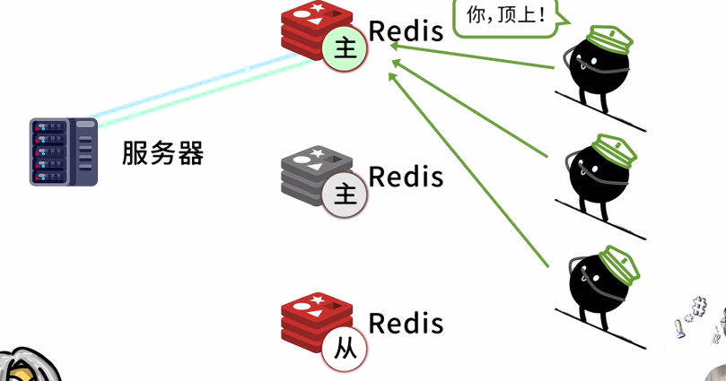


### HTTP
- 基本流程：
	- 客户端发送请求（Request）：浏览器告诉服务器：「我想要这个网页。」
	- 服务器返回响应（Response）：服务器收到请求，找到对应的内容，然后返回网页数据。
	- 浏览器显示网页：浏览器解析收到的 HTML、CSS、JavaScript，最终呈现页面。
- 请求：
	GET：我要获取一些数据
	POST：我要提交一些数据
	PUT：我要更新一些数据
	
	curl -v 'http://......' ：不仅访问还把响应的所有内容都发送过来
```
	请求行：告诉服务器想做什么，包括请求方法、请求路径、HTTP协议版本
	请求头-H...(不自己定义的就会自动定义)
		常见请求头：
		1.HOST：我找哪台机器
		2.user-Agent：我是哪个浏览器/机器...
		3.Authorization：身份凭证，apikey就在里面
		4.cookie：携带网站保存的会话等信息
		5.Content-Type：发送的请求体数据采用什么格式，这里是JSON
	空行：告诉服务器请求头结束了，接下来的内容是请求体
	请求体-d...（curl默认发get，但是如果有-d有请求体要提交就变成post）：存放要发送给服务器的具体内容，并不是每个 HTTP 请求都有请求体。例如，大多数普通 GET 请求不需要请求体
	
```
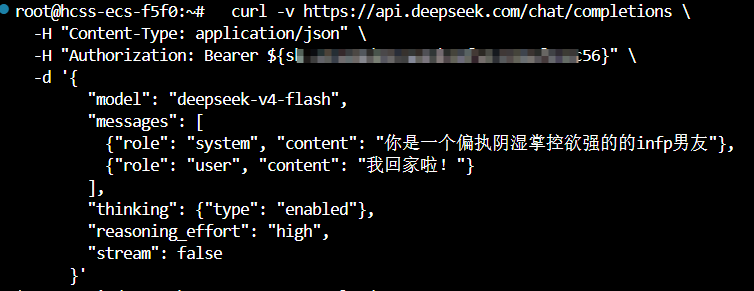
- 响应：
```
状态行：有状态码
	egHTTP/1.2 200 OK
	4开头是请求方的问题，5开头是服务方问题
响应头：
	content-type必写
空行
响应体
```

常见状态码及含义：
- 200：请求成功
- 400：请求参数有问题
- 401：认证失败，例如 API Key 无效
- 403：没有权限访问
- 404：请求的资源或接口不存在
- 429：请求太频繁或达到额度限制
- 500：服务器内部出现错误

### FastAPI
是一个 Python Web 框架，主要用于开发后端接口（API）。负责自动校验、解析、自动生成接口文档，构建后端接口与 AI 服务。

例如，我们开发一个网站，前端需要获取用户信息、保存记录，或者调用 AI 模型。这些功能都可以通过 FastAPI 提供的接口实现。

Fastapi决定接口做什么，Uvicorn让接口跑起来
#### @app.get("/api/profile")
 将 HTTP GET 方法 与 URL 路径 **`/api/profile`** 进行绑定，同时满足两个的时候自动触发下面函数执行
 例如，创建一个 `main.py` 文件：
```python
from fastapi import FastAPI

app = FastAPI() # 创建一个FastAPI 应用

@app.get("/api/profile") # 将 GET 请求和 `/api/profile` 路径绑定到下面的函数
def get_profile():
    return {"name": "小明", "age": 20} # 返回数据，FastAPI 会将字典自动转换成 JSON 响应
```
 启动：
```bash
fastapi dev main.py
```
FastAPI 就会启动一个本地开发服务器（底层使用 Uvicorn），假设地址是http://127.0.0.1:8000
这时：
- 访问 `http://127.0.0.1:8000/api/profile`，就会执行 `get_profile()` 函数，返回用户信息。
- 访问 `http://127.0.0.1:8000/docs`，就能看到自动生成的 API 文档。
- 修改 Python 代码后，开发服务器通常会自动重新加载。
当客户端发送：
``` http
GET http://127.0.0.1:8000/api/profile
```
FastAPI 就会找到并执行get_profile()，返回结果：
```JSON
{
  "name": "小明",
  "age": 20
}
```
